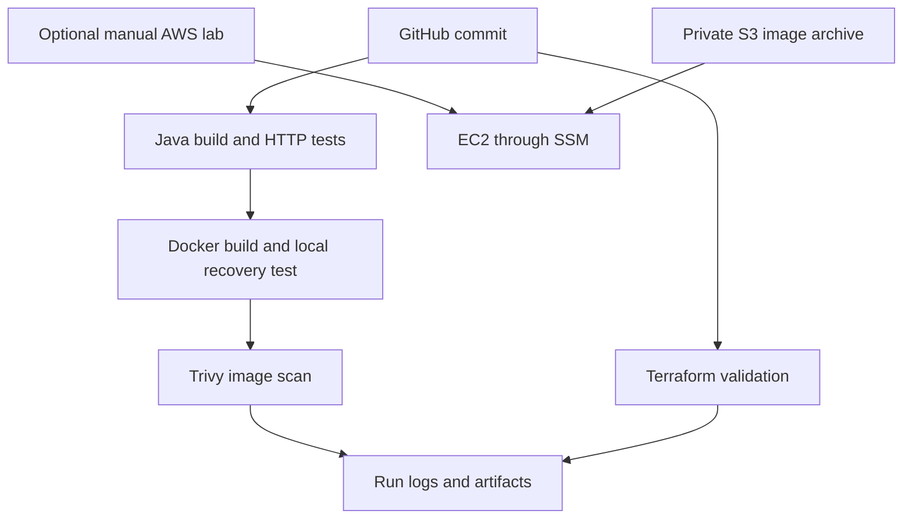

# Architecture and troubleshooting

The CI path does not call AWS. The cloud path is an optional separate lab. The app uses the Java HTTP server, not Spring Boot, Maven or a database. Replace it with your existing app once you understand packaging and health endpoints.

## Endpoint contract
GET `/` returns service/version JSON; GET `/health` returns UP/200; GET `/metrics` returns a request counter. Unknown paths return 404; non-GET requests return 405. `FAIL_HEALTH=true` intentionally returns 503 for recovery testing. Do not enable it in a healthy release.

## Local rollback design
A dedicated named container is stopped and renamed; the new image starts and is health-checked. If unhealthy, it is removed and the previous container is restarted. There is downtime. This is not blue-green routing. Containers are ownership-labelled to avoid replacing unrelated workloads. Run one deployment at a time on a dedicated Docker host.

## Diagnose common failures
- Java compiler unavailable: install a full JDK 17, not a minimal JRE.
- Port 8080 busy: stop your earlier lab or Compose service before the deployment demo.
- Docker permission denied: use an appropriately configured local Docker account; do not expose its socket to untrusted users.
- CRLF script errors on Windows: use Git Bash/WSL and LF line endings; .gitattributes is included.
- Trivy gate fails: inspect findings, refresh the base image, rerun and document any accepted risk. The starter does not promise a clean scan forever.
- Terraform init fails: provider downloads need internet; no AWS credentials are required for validate, but planning/applying needs them.
- SSM unavailable: check instance role, outbound connectivity, agent and bootstrap logs.

## Extensions not yet implemented
SonarQube quality gate, artifact publication, GitHub OIDC cloud deployment, CloudWatch collection, ALB/ASG and zero-downtime routing. Add each only after the base pipeline is reproducible.
